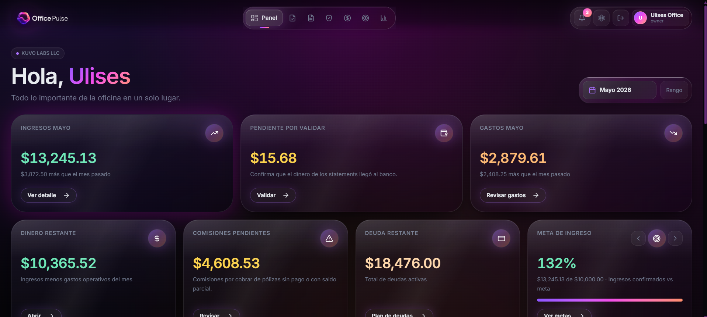
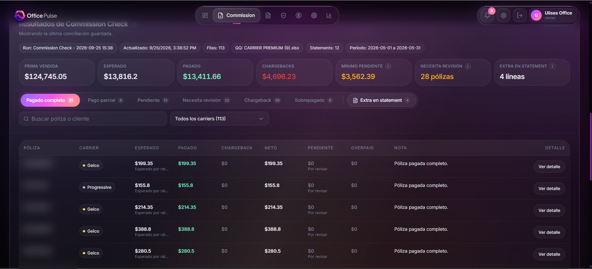
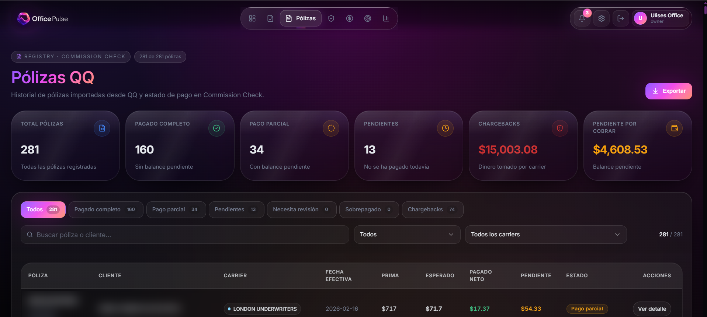
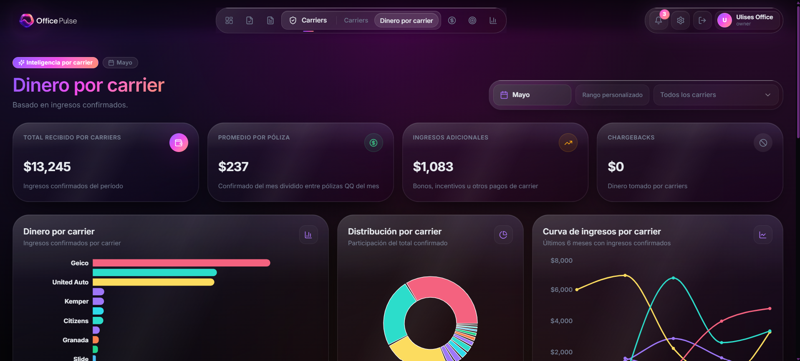
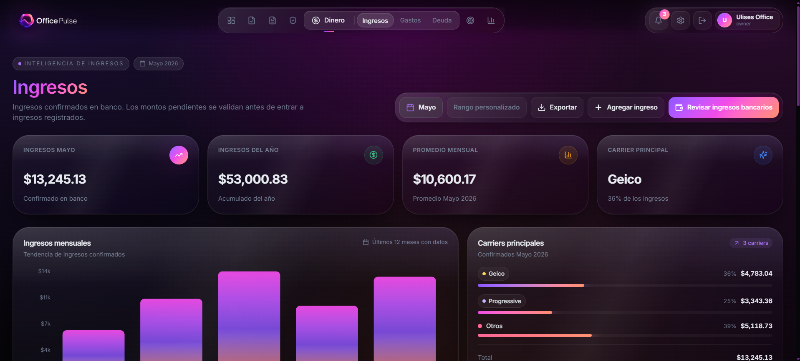
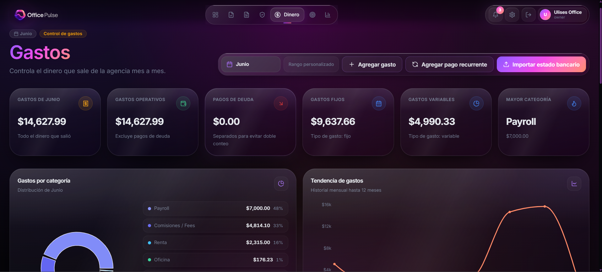
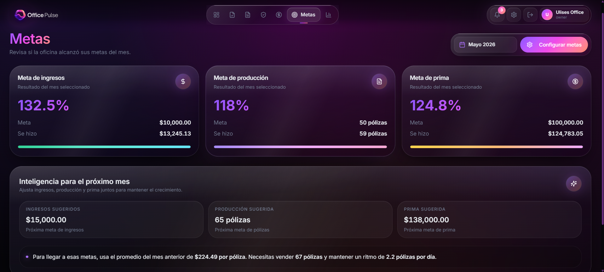
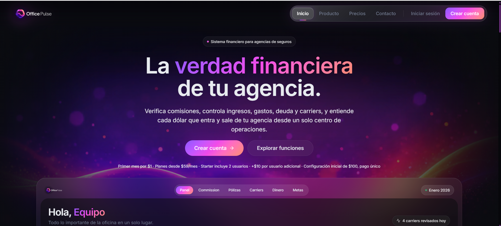
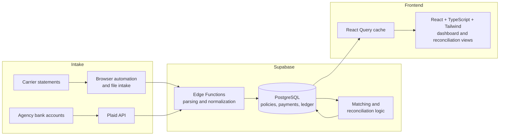

<h1 align="center">Office Pulse</h1>

  <b>Commission reconciliation and financial health platform for insurance agencies.</b> 
  Live in production with 2 paying agencies · 12,000+ transactions processed

  
  
  
  
  
  
  

> **This is a case study repository.** Office Pulse is a commercial product with real agency data, so the source code stays private. This page shows what it does, how it is built, and the engineering problems behind it.

  

---

## The problem

Insurance agencies get paid by dozens of carriers, each sending commission statements in its own format. Payments arrive partial, late, split across policies, or get clawed back as chargebacks months later. Most agency owners reconcile this by hand in Excel, so revenue leaks quietly and the leak grows as the agency scales.

I lived this problem firsthand working inside an insurance agency, building producer reports and cross-checking exports by hand. Office Pulse is the tool I wished we had.

## What it does

- **One-click commission reconciliation:** matches thousands of carrier payment lines to the exact policy each payment belongs to.
- **Flags what humans miss:** partial payments, completed payments and chargebacks, tracked against what the agency expected to be paid.
- **Policy lifecycle tracking:** commission status for every policy, from written to paid to charged back.
- **Agency financial health:** revenue, expenses, debt and money allocation in one dashboard, with KPIs and reports.
- **Goals and targets:** monthly revenue, production and premium goals, with suggested targets for next month.
- **Bank data through Plaid:** agency bank accounts connect directly, so deposits can be checked against expected commissions.
- **Replaces 40+ hours per month** of manual commission review for an agency.

## Screenshots

**Commission Check:** every carrier payment line matched to its policy, with expected vs. paid, chargebacks, partial payments and lines that need review.

| Policy registry | Money by carrier |
|---|---|
|  |  |

| Revenue | Expenses |
|---|---|
|  |  |

| Goals and next-month targets | Landing page |
|---|---|
|  |  |

The product UI is in Spanish. Policy numbers and client names are blurred.

## Architecture

## Engineering highlights

**Reconciling thousands of lines in one click.** The core challenge is allocating every payment line to the policy it actually paid, even when carriers split, merge or partially pay. When a split policy ID was double-counting revenue, I traced it to the root cause and reworked the ledger model instead of patching the symptom.

**Making ledger changes transactional.** Reconciliation actions originally ran as separate browser-side requests. I am moving those mutations behind a single controlled PostgreSQL operation, so a reconciliation either fully applies or does not apply at all. The performance goal: batch verification and matching in under a minute, and individual reconciliation actions that feel instant.

**Designed for zero training.** Agency owners are not accountants or engineers. Every screen is built so the answer is one click away: you know where to click, and you know what you get from each click.

**AI-assisted engineering workflow.** I use Claude Code and Codex daily. I own the architecture and decisions, then work in small audited passes: audit, implement, re-audit, test manually, check performance, ship. The codebase is audited weekly against real user feedback.

## Tech stack

| Layer | Tools |
|---|---|
| Frontend | React, TypeScript, Tailwind CSS, React Query |
| Backend | Supabase (PostgreSQL, Edge Functions) |
| Integrations | Plaid API, browser automation for data intake |
| Workflow | Git/GitHub, Claude Code, Codex |

## Status

Live in production since July 2026, used by 2 paying insurance agencies. Built and maintained solo by me.

---

  Built by <a href="https://www.linkedin.com/in/ulises-a-cheong-borges-1b06a540a/">Ulises A. Cheong Borges</a> · Miami, FL

